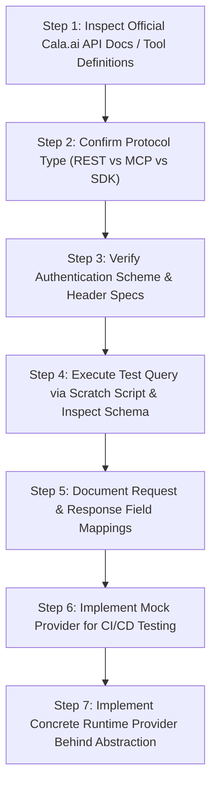

# Cala.ai Integration Requirements & Verification Checklist

**Project:** ResearchAI  
**Document Version:** 1.1.0  
**Status:** Verification Required / Pending Runtime Protocol & Contract Confirmation  

---

## 1. Executive Summary & Integration Principles

**Cala.ai** serves as the external factual knowledge retrieval provider for ResearchAI. Unlike general keyword search engines or document summarizers, Cala.ai knowledge search is optimized for **targeted, factual inquiries**. 

To maintain system reliability, avoid brittle assumptions, and prevent runtime failures, all engineering work on the Cala.ai integration must strictly adhere to the guidelines, restrictions, and verification protocols set forth in this document.

> [!WARNING]
> **Pending Verification Notice & Architectural Boundaries**: 
> 1. Variable names such as `CALA_API_KEY` and `CALA_BASE_URL` in `.env.example` are **proposed placeholder names**, not verified specifications of Cala's actual configuration or credential scheme.
> 2. **Do not assume Cala offers a standalone HTTP REST API**. Cala's production interface may utilize a Model Context Protocol (MCP) transport, a specialized client SDK, GraphQL, gRPC, or an enterprise partner gateway.
> 3. The actual production protocol, authentication flow, endpoints, request schemas, and response envelopes **must be formally verified** before writing `backend/src/services/cala.service.js`.
> 4. To shield ResearchAI from changes or protocol specifics, all retrieval operations must reside strictly behind a **provider abstraction interface**. The rest of the application (planner, analyzer, reporter) will interact solely with this abstract interface, remaining completely agnostic of the underlying transport.

---

## 2. Core Integration Rules & Constraints

### Rule 1: Factual Subquestion Formulation & Semantic Deduplication
Cala.ai knowledge search degrades or yields imprecise results when passed broad, abstract, or multi-topic keywords.
- ❌ **Do NOT submit broad topic strings**:
  - `MERN stack and AI agent development`
  - `Cloud infrastructure scalability`
  - `Artificial intelligence literature`
- ✅ **DO formulate specific, standalone factual questions**:
  - `When was MongoDB founded and what was its original core design goal?`
  - `What are the primary performance advantages of Express.js for Node.js REST APIs?`
  - `What problem does retrieval-augmented generation solve in enterprise LLM workflows?`
  - `How does token context window length impact hallucination rates in transformer models?`

**Semantic Deduplication & Diversity Preservation**:
- The planning module (`researchPlanner.js`) must perform duplicate detection and semantic-similarity filtering across proposed subquestions before dispatching them to Cala.
- Equivalent or near-synonymous factual queries (e.g., *"What is MongoDB's founding date?"* vs. *"When was MongoDB created?"*) must be collapsed into a single query to prevent redundant external retrieval and conserve API quota.
- Subquestions addressing genuinely distinct, orthogonal facets of the research question (e.g., indexing performance vs. sharding mechanics vs. memory footprint) must be carefully preserved to maintain investigative breadth.

---

### Rule 2: Separation of Dev-Time MCP vs. Production Runtime Integration
- **Development-Time MCP**: In local development or agentic prototyping, an agent environment (such as an Antigravity MCP server) may expose Cala search tools.
- **Production Runtime**: The deployed Node.js/Express backend runs independently in a cloud environment (e.g., Docker container, Linux VM, PaaS). It does **not** inherit local IDE or Antigravity MCP connections automatically.
- **Provider Abstraction Mandate**: `cala.service.js` must implement a unified provider abstraction (`ICalaKnowledgeProvider`) decoupling the caller from the underlying implementation:
  1. A production provider adapter implementing whatever protocol Cala actually supports once verified (e.g., verified REST client, official SDK, or containerized MCP client).
  2. A local mock / development bridge adapter providing deterministic responses for offline unit and integration tests.

---

### Rule 3: Strict Schema Integrity (Zero Contract Fabrication)
- **Do not invent endpoints or transport mechanisms**: Do not assume standard REST conventions like `POST /v1/search` or `POST /v2/knowledge` until verified against authoritative documentation.
- **Do not invent parameter names**: Parameter fields (e.g., `query` vs `question`, `k` vs `limit`, `max_tokens`, `search_depth`) must be verified directly against the provider's specification.
- **Do not invent authentication schemes**: Verify whether Cala uses Bearer tokens, custom headers (`X-API-Key`), mTLS, or an OAuth exchange.

---

### Rule 4: Absolute Citation & Metadata Truthfulness
- **Zero Fabrication**: The system must never hallucinate, invent, or extrapolate source URLs, titles, authors, or publication dates.
- **Preserve Source Metadata**: All metadata returned by Cala (`title`, `url`, `snippet`, `author`, `publishedDate`) must be preserved verbatim in the `ResearchSource` database record.
- **Handling Incomplete Metadata**: If a source lacks an author or publication date, store `null` or empty strings. Never invent missing bibliographic elements.

---

### Rule 5: Error Resilience & Graceful Fallback
- **Empty Result Sets**: If Cala returns no results for a factual subquestion, `cala.service.js` must return an empty array `[]` rather than throwing an uncaught error. The subquestion is flagged as an unverified knowledge gap.
- **Rate Limits & Backoff (HTTP 429 / Quota Blocks)**: The provider adapter must implement exponential backoff retry logic (up to 2 retries) with circuit breaking to prevent cascading pipeline failure.

---

## 3. Engineering Verification Checklist

Before implementing `backend/src/services/cala.service.js`, the engineering team must execute and verify every item in this matrix:



### Verification Matrix

| Checklist Item | Requirement | Verification Method | Status |
| :--- | :--- | :--- | :--- |
| **VC-01** | **Protocol & Transport Identification** | Confirm whether runtime access uses HTTP REST, an MCP client bridge, GraphQL, or an official Node.js SDK. Do not assume REST. | 🟡 *Pending Verification* |
| **VC-02** | **Authentication Scheme & Config** | Confirm actual credential format, header names (`Authorization: Bearer`, `x-api-key`, etc.), and verify if `CALA_API_KEY` / `CALA_BASE_URL` match requirements. | 🟡 *Pending Verification* |
| **VC-03** | **Endpoint URL / Method / Tool Name** | If REST/GraphQL: document exact base URL and methods. If MCP: document exact tool names (e.g. `knowledge_search`, `knowledge_query`) and transport. | 🟡 *Pending Verification* |
| **VC-04** | **Request Payload Schema** | Verify exact parameter names (e.g. `question` vs `query`, `max_results` vs `limit`, filtering flags). | 🟡 *Pending Verification* |
| **VC-05** | **Response Payload Envelope** | Document exact response schema (e.g. nested keys, snippet fields, metadata attributes) and error envelopes. | 🟡 *Pending Verification* |
| **VC-06** | **Latency & Timeout Thresholds** | Measure p95 response times on sample factual queries to set appropriate client timeouts. | 🟡 *Pending Verification* |
| **VC-07** | **Rate Limiting & Concurrency Rules** | Determine requests-per-minute (RPM), daily quotas, and concurrent connection caps. | 🟡 *Pending Verification* |
| **VC-08** | **Offline Mock Provider** | Implement a mock provider satisfying `ICalaKnowledgeProvider` for CI/CD test suites and local prototyping. | 🟡 *Pending Implementation* |

---

## 4. Provider Abstraction Architecture (`cala.service.js`)

To decouple the application core from the verified runtime integration method, `cala.service.js` will export a clean provider interface:

```javascript
/**
 * Normalized source finding returned to the ResearchAI pipeline.
 * @typedef {Object} NormalizedCalaFinding
 * @property {string} title - Title of the source document or webpage.
 * @property {string} url - Canonical URL of the evidence source.
 * @property {string} snippet - Raw factual text excerpt.
 * @property {string|null} [author] - Document author if provided.
 * @property {string|null} [publishedDate] - Publication date if provided.
 * @property {number} [relevanceScore] - Retrieval confidence metric.
 */

/**
 * Abstract Knowledge Provider Interface
 */
export class ICalaKnowledgeProvider {
  /**
   * @param {string} factualQuestion - Specific factual query
   * @param {Object} [options]
   * @returns {Promise<NormalizedCalaFinding[]>}
   */
  async search(factualQuestion, options = {}) {
    throw new Error("Method search() must be implemented by concrete provider.");
  }
}

/**
 * Standardized Service Export
 * Delegates to the configured concrete provider (Mock, REST, MCP, or SDK).
 */
export const CalaService = {
  /**
   * Search external knowledge via the active provider.
   * @param {string} factualQuestion
   * @param {Object} [options]
   * @returns {Promise<NormalizedCalaFinding[]>}
   */
  async search(factualQuestion, options = {}) {
    // Delegates to active concrete implementation once VC-01 through VC-05 are verified.
    throw new Error("CalaService is pending runtime protocol verification (VC-01).");
  }
};
```
