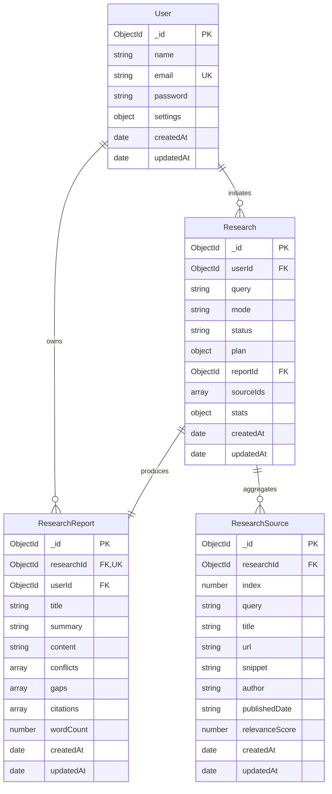

# MongoDB Database Design

**Project:** ResearchAI  
**Document Version:** 1.0.0  
**Status:** Approved for Design / Pending Implementation Review  

---

## 1. Overview & Data Modeling Strategy

ResearchAI uses **MongoDB** with **Mongoose ODM** to store user information, research sessions, evidence sources, and generated analytical reports. 

The data design favors **referential separation for large, independent text documents** (such as full reports and source archives) to avoid hitting the 16MB MongoDB BSON document limit, while leveraging **lightweight embedded subdocuments** for tightly-coupled metadata (such as research plans and user preferences).



---

## 2. Collection Schemas & Specifications

### 2.1 Collection: `users`
Stores user profile information, authentication credentials, and user-level defaults.

| Field | Type | Constraints | Description |
| :--- | :--- | :--- | :--- |
| `_id` | `ObjectId` | Primary Key, Auto | Unique user identifier |
| `name` | `String` | Required, Trimmed, Max: 100 | Full name or display name |
| `email` | `String` | Required, Unique, Lowercase, Trimmed | Unique user email address |
| `password` | `String` | Required | Hashed password (`bcrypt` salt rounds >= 10) |
| `settings` | `Object` | Optional | User configuration |
| `settings.defaultMode` | `String` | Enum: `['quick', 'standard', 'deep']`, Default: `'standard'` | Preferred research execution mode |
| `settings.theme` | `String` | Enum: `['light', 'dark', 'system']`, Default: `'system'` | Preferred UI appearance |
| `createdAt` | `Date` | Auto | Timestamp when record was created |
| `updatedAt` | `Date` | Auto | Timestamp when record was last updated |

#### Mongoose Index Definitions
```javascript
userSchema.index({ email: 1 }, { unique: true });
```

---

### 2.2 Collection: `researches`
Represents an individual research inquiry initiated by a user. Tracks pipeline execution state, subquestion plans, and links to generated reports and sources.

| Field | Type | Constraints | Description |
| :--- | :--- | :--- | :--- |
| `_id` | `ObjectId` | Primary Key, Auto | Unique research session identifier |
| `userId` | `ObjectId` | Required, Ref: `User` | Owner of the research session |
| `query` | `String` | Required, Trimmed, Min: 10, Max: 1000 | The raw natural-language prompt |
| `mode` | `String` | Enum: `['quick', 'standard', 'deep']`, Default: `'standard'` | Selected research depth |
| `status` | `String` | Enum: `['queued', 'planning', 'retrieving', 'analyzing', 'generating', 'completed', 'failed']` | Current pipeline execution stage |
| `plan` | `Object` | Embedded | Generated research plan |
| `plan.scope` | `String` | Optional | Scope definition generated by planner |
| `plan.subquestions` | `[String]` | Default: `[]` | Factual subquestions generated for search |
| `reportId` | `ObjectId` | Optional, Ref: `ResearchReport` | Reference to completed report (null while running) |
| `sourceIds` | `[ObjectId]` | Ref: `ResearchSource`, Default: `[]` | References to all retrieved sources |
| `stats` | `Object` | Optional | Performance and operational metrics |
| `stats.durationMs` | `Number` | Default: 0 | Total pipeline execution time in milliseconds |
| `stats.sourcesRetrieved` | `Number` | Default: 0 | Count of sources fetched |
| `stats.error` | `String` | Optional | Error message if status transitioned to `'failed'` |
| `createdAt` | `Date` | Auto | Creation timestamp |
| `updatedAt` | `Date` | Auto | Last updated timestamp |

#### Mongoose Index Definitions
```javascript
// Optimized for user history retrieval sorted by date
researchSchema.index({ userId: 1, createdAt: -1 });

// Optimized for background worker status checks
researchSchema.index({ status: 1 });
```

---

### 2.3 Collection: `researchreports`
Stores the finalized synthesized Markdown research report, along with structured metadata regarding detected discrepancies, knowledge gaps, and verified citations.

| Field | Type | Constraints | Description |
| :--- | :--- | :--- | :--- |
| `_id` | `ObjectId` | Primary Key, Auto | Unique report identifier |
| `researchId` | `ObjectId` | Required, Unique, Ref: `Research` | Associated research session |
| `userId` | `ObjectId` | Required, Ref: `User` | Owner reference |
| `title` | `String` | Required, Trimmed | Generated report title |
| `summary` | `String` | Required | High-level executive summary |
| `content` | `String` | Required | Full synthesized Markdown report content |
| `conflicts` | `[Object]` | Default: `[]` | Discrepancies and competing evidence points |
| `conflicts[].topic` | `String` | Required | Thematic subtopic where conflict was found |
| `conflicts[].claimA` | `String` | Required | First claim with source reference |
| `conflicts[].claimB` | `String` | Required | Competing claim with source reference |
| `conflicts[].resolution` | `String` | Optional | Analytical resolution or explanation |
| `gaps` | `[String]` | Default: `[]` | Unanswered questions or missing evidence areas |
| `citations` | `[Object]` | Default: `[]` | Citation index table |
| `citations[].marker` | `Number` | Required | Numerical marker used in Markdown (e.g., `1` for `[1]`) |
| `citations[].sourceId` | `ObjectId` | Required, Ref: `ResearchSource` | Persistent source reference |
| `wordCount` | `Number` | Default: 0 | Total word count of the report body |
| `createdAt` | `Date` | Auto | Creation timestamp |
| `updatedAt` | `Date` | Auto | Last updated timestamp |

#### Mongoose Index Definitions
```javascript
researchReportSchema.index({ researchId: 1 }, { unique: true });
researchReportSchema.index({ userId: 1, createdAt: -1 });
```

---

### 2.4 Collection: `researchsources`
Stores individual retrieved external evidence snippets, canonical URLs, and metadata retrieved via Cala.ai.

| Field | Type | Constraints | Description |
| :--- | :--- | :--- | :--- |
| `_id` | `ObjectId` | Primary Key, Auto | Unique source record identifier |
| `researchId` | `ObjectId` | Required, Ref: `Research` | Associated research session |
| `index` | `Number` | Required, Min: 1 | Sequential reference index within the research session (`1` maps to citation `[1]`) |
| `query` | `String` | Required | The factual subquestion that retrieved this source |
| `title` | `String` | Required, Trimmed | Extracted title of the document or page |
| `url` | `String` | Required, Trimmed | Canonical source URL |
| `snippet` | `String` | Required | Extracted textual evidence passage |
| `author` | `String` | Optional, Default: `""` | Document author or publisher |
| `publishedDate` | `String` | Optional, Default: `""` | Publication date string if available |
| `relevanceScore` | `Number` | Optional, Min: 0, Max: 1 | Retrieval relevance metric |
| `createdAt` | `Date` | Auto | Creation timestamp |
| `updatedAt` | `Date` | Auto | Last updated timestamp |

#### Mongoose Index Definitions
```javascript
// Fast lookup of sources by session and numerical citation index
researchSourceSchema.index({ researchId: 1, index: 1 }, { unique: true });

// Deduplication index per research session
researchSourceSchema.index({ researchId: 1, url: 1 });
```

---

## 3. Data Integrity & Cascading Rules

1. **Orphan Prevention**:
   - When a user deletes a `Research` record, a Mongoose pre-remove hook or transactional service method must delete the corresponding `ResearchReport` document and all associated `ResearchSource` documents.
2. **Citation Consistency**:
   - The numerical `index` on `ResearchSource` is immutable once assigned during the execution phase.
   - The `citations` array on `ResearchReport` guarantees referential integrity between in-text markers (`[1]`, `[2]`) and the MongoDB `_id` of the actual `ResearchSource` entity.
3. **Immutability of Final Reports**:
   - Once a research status reaches `completed`, its associated `ResearchReport` and `ResearchSource` documents are treated as immutable historical records to guarantee reproducibility.

