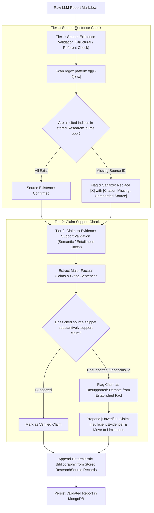

# Research Agent Pipeline & Processing Logic

**Project:** ResearchAI  
**Document Version:** 1.1.0  
**Status:** Approved for Design / Pending Implementation Review  

---

## 1. Pipeline Overview & Philosophy

The ResearchAI research pipeline operates on the principle of **epistemic grounding**: generative language models must not answer research queries from latent training memory alone. Instead, every empirical statement, statistic, and comparative claim must be anchored in verified external evidence retrieved from **Cala.ai**, with explicit tracking of ambiguities, contradictions, and information gaps.

```mermaid
flowchart TD
    UserQuery["User Research Question + Mode"] --> Planner["researchPlanner.js"]
    
    subgraph PlanningPhase ["1. Planning & Query Decomposition"]
        Planner --> Decomposer["Decompose Topic into Factual Subquestions"]
        Decomposer --> CalaFormatter["Convert into Specific Factual Queries"]
        CalaFormatter --> SimilarityCheck["Semantic Similarity & Deduplication Filter"]
    end
    
    subgraph RetrievalPhase ["2. External Knowledge Retrieval"]
        SimilarityCheck --> CalaAdapter["cala.service.js (Provider Abstraction)"]
        CalaAdapter --> Deduplicator["Deduplicate & Normalize Sources"]
    end
    
    subgraph AnalysisPhase ["3. Evidence Analysis & Synthesis"]
        Deduplicator --> Analyzer["researchAnalyzer.js"]
        Analyzer --> Credibility["Evaluate Evidence & Detect Conflicts"]
        Credibility --> Gaps["Identify Knowledge Gaps"]
    end
    
    subgraph GenerationPhase ["4. Report Generation & Two-Tier Validation"]
        Gaps --> Reporter["reportGenerator.js"]
        Reporter --> LLMSynth["LLM Markdown Generation"]
        LLMSynth --> Tier1Validation["Tier 1: Source Existence Validation"]
        Tier1Validation --> Tier2Validation["Tier 2: Claim-to-Evidence Support Validation"]
    end

    subgraph PersistencePhase ["5. Persistence & Delivery"]
        Tier2Validation --> DeterministicBib["Append Deterministic Stored Bibliography"]
        DeterministicBib --> MongoSave["Save to MongoDB (ResearchReport, Sources)"]
        MongoSave --> ClientReady["Status: Completed (Ready for User)"]
    end
```



---

## 2. Detailed 10-Step Processing Lifecycle

### Step 1: Ingestion & Validation
- **Trigger**: `researchExecutor.js` receives the user inquiry, user identity, and mode (`quick`, `standard`, `deep`).
- **Logic**: Validates text length (10 to 1,000 characters), validates authentication, creates the `Research` document in MongoDB with status `queued`, and begins asynchronous workflow execution.

### Step 2: Structured Research Planning
- **Module**: `researchPlanner.js` (invoking `llm.service.js`).
- **Prompt Strategy**: System prompt instructs the model to act as a Principal Research Director, establishing the scope boundaries, technical dimensions, and criteria for resolution.
- **Output**: A structured plan summary describing the investigation trajectory.

### Step 3: Subquestion Decomposition
- **Module**: `researchPlanner.js`.
- **Logic**: Breaks the high-level prompt into discrete, non-overlapping analytical angles based on the research mode:
  - *Quick Mode*: 1 – 2 subquestions.
  - *Standard Mode*: 3 – 5 subquestions.
  - *Deep Mode*: 6 – 10 subquestions.

### Step 4: Factual Query Conversion & Semantic Deduplication
- **Module**: `researchPlanner.js`.
- **Critical Integration Rule**: External knowledge retrieval engines fail when given broad, multi-concept topic labels. The planner transforms open-ended conceptual queries into targeted, factual questions.
  - ❌ **Broad Topic (Avoid)**: `MERN stack and AI agent development`
  - ✅ **Targeted Factual Query 1**: `What architectural patterns connect Express.js backends with streaming LLM agents?`
  - ✅ **Targeted Factual Query 2**: `How does MongoDB store unstructured JSON documents compared to relational databases?`
  - ✅ **Targeted Factual Query 3**: `What problem does retrieval-augmented generation solve in enterprise search?`
- **Duplicate & Semantic-Similarity Checks**:
  - The planner executes a semantic similarity and deduplication pass over candidate factual queries before dispatching them to Cala.
  - **Eliminating Redundancy**: Equivalent or semantically overlapping questions (e.g., *"What is MongoDB's founding date?"* vs *"When was MongoDB created?"*) are identified and collapsed into a single canonical query, preventing redundant API calls and conserving quota.
  - **Preserving Investigative Breadth**: Queries that address genuinely distinct, orthogonal aspects of the topic (e.g., query A investigating concurrency bottlenecks vs query B investigating memory cache strategies vs query C evaluating licensing terms) are strictly preserved.

### Step 5: External Retrieval via Cala.ai Provider Abstraction
- **Module**: `cala.service.js`.
- **Logic**: Dispatches the deduplicated factual queries through the provider abstraction layer.
- **Resilience**: Executes queries with concurrency controls and a per-request timeout. If a query returns an error or empty set, the service logs the event and continues rather than terminating the pipeline.

### Step 6: Normalization & Deduplication of Findings
- **Module**: `cala.service.js` & `researchExecutor.js`.
- **Logic**:
  1. Extracts uniform fields: `title`, `url`, `snippet`, `author`, `publishedDate`.
  2. Normalizes canonical URLs (stripping tracking query parameters like `utm_*`).
  3. Deduplicates identical source URLs across subquestions.
  4. Assigns each unique source an immutable numerical index (`1, 2, 3...`) mapped to citation tags `[1]`, `[2]`.
  5. Persists the normalized sources to the `researchsources` collection in MongoDB.

### Step 7: Credibility, Conflict & Gap Evaluation
- **Module**: `researchAnalyzer.js` (invoking `llm.service.js`).
- **Logic**:
  - Ingests all normalized evidence snippets.
  - Compares empirical assertions across sources: detects numerical discrepancies, conflicting timelines, or competing architectural recommendations.
  - Compares the retrieved facts against the planned subquestions to identify remaining **knowledge gaps** (subquestions where retrieved evidence is insufficient).

### Step 8: LLM Evidence Synthesis
- **Module**: `researchAnalyzer.js`.
- **Prompt Strategy**: Strictly forbids the LLM from inventing outside facts. The model produces an intermediate structured JSON synthesis containing verified statements keyed to source indices and explicit flags for unverified assertions.

### Step 9: Report Generation & Two-Tier Validation
- **Module**: `reportGenerator.js`.
- **Logic**:
  - Compiles the synthesis into a publication-ready Markdown report.
  - Generates standardized report sections:
    1. Executive Summary
    2. Background & Scope
    3. Detailed Findings (with in-text citations `[n]`)
    4. Comparative Matrix & Tradeoffs
    5. Discrepancies & Conflicting Claims
    6. Limitations & Unanswered Gaps
    7. Conclusions & Strategic Recommendations
    8. References & Verified Source Index
  - **Two-Tier Validation Execution**: Runs both Tier 1 (Source Existence Validation) and Tier 2 (Claim-to-Evidence Support Validation) detailed in Section 4.

### Step 10: Finalization & Persistence
- **Module**: `researchExecutor.js`.
- **Logic**: Creates the `ResearchReport` document, updates the `Research` record with status `completed`, sets the execution duration, and persists the full audit record.

---

## 3. Module Interface Specifications

### 3.1 `researchPlanner.js`
```javascript
/**
 * Decomposes a research prompt into an overall plan, converts broad topics
 * into targeted factual queries, and filters out semantic duplicates.
 * @param {string} query - User research question.
 * @param {'quick' | 'standard' | 'deep'} mode - Research depth mode.
 * @returns {Promise<{ scope: string, factualSubquestions: string[] }>}
 */
export async function generateResearchPlan(query, mode) { ... }
```

### 3.2 `cala.service.js`
```javascript
/**
 * Executes a factual query against the Cala.ai knowledge retrieval provider.
 * Implemented behind the ICalaKnowledgeProvider abstraction.
 * @param {string} factualQuery - Specific, deduplicated factual question.
 * @param {number} limit - Maximum number of sources to return.
 * @returns {Promise<Array<{ title: string, url: string, snippet: string, author?: string, publishedDate?: string }>>}
 */
export async function searchCalaKnowledge(factualQuery, limit) { ... }
```

### 3.3 `researchAnalyzer.js`
```javascript
/**
 * Analyzes normalized sources to extract verified synthesis, conflicts, and gaps.
 * @param {Array<Object>} sources - Normalized sources with assigned index.
 * @param {Object} plan - The original research plan.
 * @returns {Promise<{ synthesis: Object, conflicts: Array<Object>, gaps: string[] }>}
 */
export async function analyzeEvidence(sources, plan) { ... }
```

### 3.4 `reportGenerator.js`
```javascript
/**
 * Assembles the final Markdown report, runs Tier 1 & Tier 2 validation,
 * and appends a deterministic bibliography from stored records.
 * @param {Object} params - Synthesis, sources, and metadata.
 * @returns {Promise<{ title: string, summary: string, content: string, auditReport: Object }>>}
 */
export async function generateFinalReport({ query, plan, synthesis, conflicts, gaps, sources }) { ... }
```

---

## 4. Two-Tier Citation & Evidence Validation Framework

To ensure absolute factual reliability and prevent hallucinated citations or unsupported assertions from entering the final report, ResearchAI separates **source existence validation** from **claim-to-evidence support validation**.



### Tier 1: Source Existence Validation (Structural / Referent Check)
- **Objective**: Ensure that every citation marker in the text mathematically corresponds to a persistent `ResearchSource` record in the database.
- **Mechanism**:
  1. Scans the report Markdown using regex `/(?:\[(\d+)\])/g` to extract the cited index set `{citedIndices}`.
  2. Retrieves the set of actually retrieved and stored source indices `{validIndices}` from MongoDB (`1..N`).
  3. Verifies `{citedIndices} ⊆ {validIndices}`.
  4. **Remediation**: If an out-of-bounds index (e.g. `[14]` when only 6 sources exist) is detected, the auditor replaces the marker with `[Citation Missing: Unrecorded Source]` and records a structural audit anomaly.

### Tier 2: Claim-to-Evidence Support Validation (Semantic / Entailment Check)
- **Objective**: Ensure that a validly cited source actually corroborates the specific factual assertion being made. (Preventing the model from citing a real source about database installation to back up an unrelated benchmark statistic).
- **Mechanism**:
  1. The analyzer and report generator parse important factual claims and their associated citation targets.
  2. The system checks the sentence assertion against the retrieved text snippet of the cited `ResearchSource`.
  3. **Classification**:
     - **Verified Claim**: The evidence snippet explicitly substantiates the claim. The claim is presented as established fact with its citation tag.
     - **Unsupported Claim**: The evidence snippet does not contain the claimed data, or contradicts it. The system **prohibits** presenting the statement as an established fact. The statement is either flagged with `[Unverified: Insufficient Source Evidence]`, rephrased as an unconfirmed conjecture, or routed to the **Research Limitations & Knowledge Gaps** section.

### Deterministic Bibliography Generation
- The references and bibliography section at the end of the report is **never generated by LLM free-text completion**.
- It is rendered **programmatically from MongoDB `ResearchSource` records**, including exact canonical URLs, retrieved titles, authors, and timestamps. This ensures 0% hallucinated external links or corrupt bibliographic citations.

---

## 5. Mode-Specific Constraints & Defaults

| Configuration Key | Quick Mode | Standard Mode | Deep Mode | Config Source |
| :--- | :--- | :--- | :--- | :--- |
| `MAX_SUBQUESTIONS` | 2 | 5 | 10 | `src/config/research.config.js` |
| `SOURCES_PER_QUERY` | 3 | 4 | 6 | `src/config/research.config.js` |
| `TIMEOUT_PER_QUERY_MS` | 8,000 ms | 12,000 ms | 20,000 ms | `src/config/research.config.js` |
| `ENABLE_CONFLICT_ANALYSIS` | False (Light) | True | True (Comprehensive) | `src/config/research.config.js` |
| `ENABLE_TIER2_CLAIM_VALIDATION` | Heuristic Check | Standard Entailment | Deep Cross-Validation | `src/config/research.config.js` |
| `TOTAL_PIPELINE_TIMEOUT_MS` | 30,000 ms | 60,000 ms | 120,000 ms | `src/config/research.config.js` |

All limits are stored as environment-overridable configuration constants, ensuring elasticity without requiring architectural changes.
