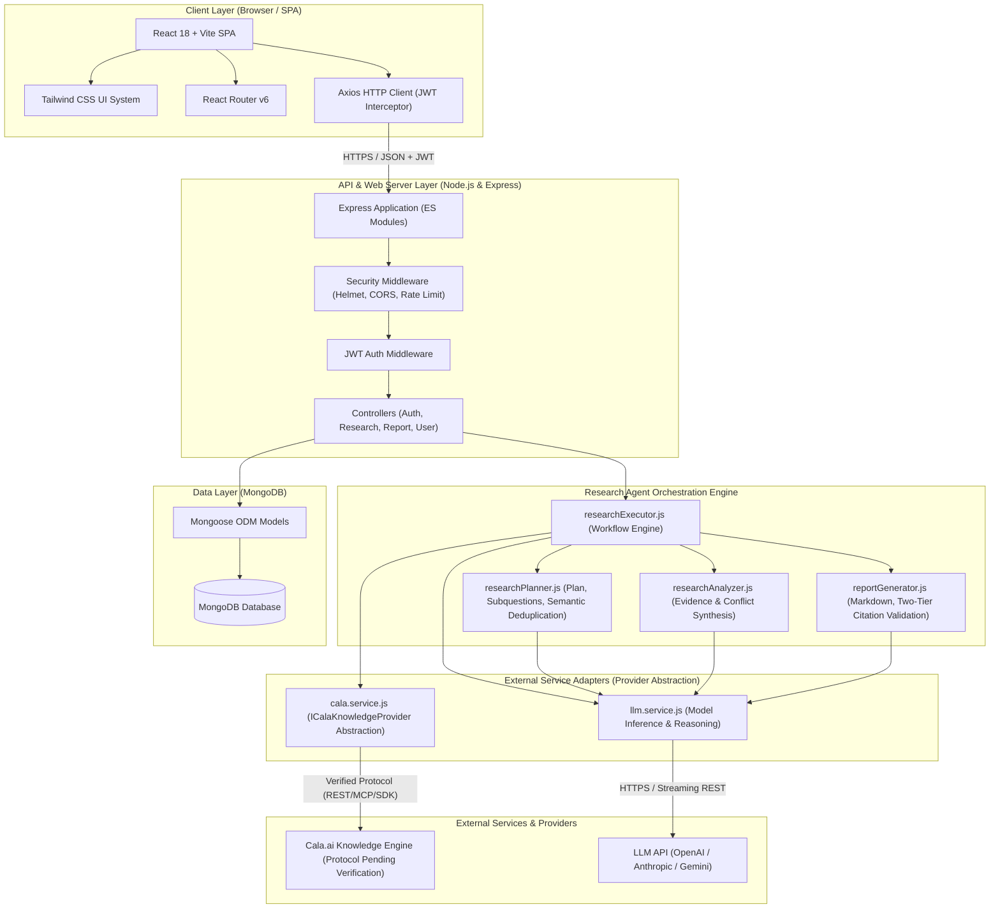
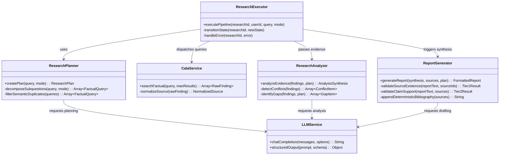

# System Architecture Specification

**Project:** ResearchAI  
**Document Version:** 1.1.0  
**Status:** Approved for Design / Pending Implementation Review  

---

## 1. Architectural Overview

ResearchAI employs a decoupled, multi-tier client-server architecture built on modern JavaScript and ECMAScript modules. The system separates user presentation, RESTful business orchestration, agent-based research intelligence, persistence, and external service communication into distinct, loosely-coupled layers.

---

## 2. Component Responsibilities & Communication

### 2.1 Client Layer (Frontend)
- **Technology Stack**: React 18, Vite, Tailwind CSS, React Router v6, Axios, Recharts (optional for analytics visualizations).
- **Responsibilities**:
  - Render an intuitive, responsive research dashboard and interactive workspace.
  - Handle user authentication state and manage JWT tokens in memory or secure storage with automated request headers.
  - Formulate and validate research queries and capture user-selected research modes (`quick`, `standard`, `deep`).
  - Periodically poll or stream research job status updates (`planning`, `retrieving`, `analyzing`, `generating`).
  - Render structured Markdown reports with interactive citation popovers, support confidence tags, and discrepancy inspectors.
- **Communication Protocol**: Communicates with the backend exclusively via HTTPS/JSON over standard RESTful conventions using an Axios interceptor injecting `Authorization: Bearer <token>`.

### 2.2 Server & API Layer (Backend)
- **Technology Stack**: Node.js (v20+), Express.js, native ECMAScript Modules (`import`/`export`), Mongoose ODM.
- **Responsibilities**:
  - Expose versioned REST endpoints (`/api/auth`, `/api/research`, `/api/reports`, `/api/users`).
  - Apply defense-in-depth middleware: CORS whitelisting, HTTP header security via Helmet, request payload limits, and IP-based rate limiting.
  - Authenticate incoming requests, decode and verify JWTs, and attach authenticated user context to the request pipeline.
  - Validate request payloads with schema validators before passing parameters to service controllers.
  - Hand off research tasks to the asynchronous Agent Orchestration Engine while immediately returning session references to the client.

### 2.3 Research Agent Orchestration Engine
The agent layer encapsulates the core intelligence of ResearchAI. It isolates domain reasoning into four distinct modules:
1. `researchPlanner.js`: Generates a research roadmap, breaks down broad topics into targeted factual questions, and applies duplicate and semantic-similarity filtering to avoid redundant external queries while preserving distinct investigation facets.
2. `researchExecutor.js`: Orchestrates the step-by-step pipeline execution, state transitions, and error recovery.
3. `researchAnalyzer.js`: Normalizes evidence, evaluates source credibility, cross-references claims, and extracts contradictions and gaps.
4. `reportGenerator.js`: Synthesizes final reports in Markdown, runs two-tier citation validation (source existence check and claim-to-evidence support check), flags unsupported claims, and deterministically generates bibliographies from stored `ResearchSource` records.

### 2.4 External Service Adapters & Provider Abstraction
To protect the core business logic from third-party vendor lock-in, unverified assumptions, or breaking protocol changes:
- **`cala.service.js` (Provider Abstraction)**:
  - Operates behind an abstract `ICalaKnowledgeProvider` interface. The rest of ResearchAI remains strictly decoupled from the concrete integration protocol.
  - **No Standalone REST Assumption**: Do not assume Cala provides a standard REST API; the verified runtime protocol could be an official SDK, MCP bridge, GraphQL, or REST.
  - **Proposed Configuration**: Environment variable names like `CALA_API_KEY` and `CALA_BASE_URL` in `.env.example` are proposed placeholders pending verification of the actual credential and endpoint specifications.
  - Standardizes search inputs, handles pagination, query timeouts, rate limits, and extracts normalized source metadata (`title`, `url`, `snippet`, `author`, `publishedDate`).
- **`llm.service.js`**:
  - Interfaces with the configured LLM provider (e.g., OpenAI, Gemini, Anthropic), managing structured system prompts, JSON mode enforcement, token limits, and exponential backoff retry mechanisms.

### 2.5 Data Layer (MongoDB)
- Stores persistent application entities: `User`, `Research`, `ResearchReport`, and `ResearchSource`.
- Enforces relational consistency, data indexing, and temporal auditing (`createdAt`, `updatedAt`).

---

## 3. Research Agent Architecture & Workflow

### 3.1 Module Breakdown

#### 1. `researchPlanner.js`
- **Responsibility**: Ingests user question and mode. Decomposes the topic into specific factual search queries, converts broad topics into targeted questions, and performs duplicate and semantic similarity checks.
- **Deduplication vs Diversity**: Eliminates redundant or near-identical questions to conserve API quota while retaining distinct questions that explore genuinely different angles of the topic.

#### 2. `cala.service.js`
- **Responsibility**: Dispatches factual subquestions through the verified provider adapter. Normalizes varied responses into uniform `ResearchSource` objects and deduplicates findings.

#### 3. `researchAnalyzer.js`
- **Responsibility**: Cross-examines retrieved snippets against subquestions. Evaluates evidence credibility, identifies conflicting data points across sources, and flags information gaps.

#### 4. `reportGenerator.js`
- **Responsibility**: Synthesizes the Markdown report and performs a **Two-Tier Validation**:
  - **Tier 1 (Source Existence)**: Verifies that every `[n]` citation corresponds to an actual stored `ResearchSource` ID.
  - **Tier 2 (Claim Support)**: Verifies that the cited source snippet genuinely substantiates the factual claim.
  - **Unsupported Claim Handling**: Flags unsupported claims, avoids presenting them as established facts, and moves speculative statements to the limitations section.
  - **Deterministic Bibliography**: Renders the references section directly from database records.

---

## 4. Research Modes & Execution Profiles

| Dimension | Quick Mode | Standard Mode | Deep Mode |
| :--- | :--- | :--- | :--- |
| **Primary Goal** | Rapid, concise summary of straightforward topics | Balanced analysis of multifaceted questions | Exhaustive, multi-angle technical investigation |
| **Factual Subquestions** | 1 – 2 queries (deduplicated) | 3 – 5 queries (deduplicated) | 6 – 10 queries (deduplicated) |
| **Target Sources per Query** | 2 – 3 sources | 3 – 5 sources | 5 – 8 sources |
| **Conflict & Gap Detection** | Basic / Pass-through | Standard pairwise checking | Deep cross-source synthesis & gap audit |
| **Claim-to-Evidence Check** | Heuristic validation | Standard entailment check | Comprehensive claim verification |
| **Synthesis Depth** | Executive summary & bullet points | Structured sections with comparison tables | Detailed multi-chapter analysis & tradeoff matrix |
| **Execution Architecture** | Inline async process | Async worker / polling | Background job / event-driven polling |

> [!NOTE]
> Specific query counts and source limits are maintained in backend configuration constants (`src/config/research.config.js`) rather than hardcoded logic, enabling runtime tuning without code modification.

---

## 5. Reliability, Security & Research Quality Architecture

### 5.1 Environment Variable Protection
All sensitive secrets (MongoDB connection strings, JWT signing keys, proposed Cala credentials, and LLM API keys) must be loaded exclusively at server startup via environment variables. Under no circumstances are secrets committed to source repositories or sent in client payloads.

### 5.2 Input Validation & Request Throttling
- User inputs undergo strict type, length, and content validation using declarative schemas (e.g., Joi / Zod).
- Rate limiting middleware (e.g., `express-rate-limit`) prevents brute-force authentication attacks and curbs API abuse by throttling research creation requests per user and IP address.

### 5.3 Asynchronous Execution & Job Queues
Deep research pipelines can take up to 90 seconds. To prevent HTTP connection timeouts and worker blocking:
- The HTTP handler immediately creates the `Research` record, dispatches the background task, and returns `201 Created` with a session ID.
- In the initial development phase, Node.js asynchronous event dispatching coordinates the workflow while updating state in MongoDB.
- In high-throughput production phases, this architecture cleanly abstracts to a distributed Redis/BullMQ worker architecture.

### 5.4 Two-Tier Citation Integrity & Grounding
1. **Source Grounding**: The LLM prompt restricts report drafting to the explicitly provided source snippets.
2. **Tier 1 (Source Existence Validation)**: The auditor scans for all `\[(\d+)\]` citation tags and verifies they exist in the stored `ResearchSource` collection. Any phantom tags are stripped and flagged.
3. **Tier 2 (Claim-to-Evidence Support Validation)**: Important factual assertions are cross-checked against the content of the cited evidence snippet. Claims that lack direct evidence are explicitly flagged as unverified and prevented from being stated as established facts.
4. **Deterministic Bibliography**: The final reference table is programmatically rendered from verified database records, guaranteeing zero hallucinated URLs, authors, or titles.
5. **Mandatory Disclosure of Uncertainty**: If retrieved evidence is missing or inconclusive, the agent explicitly documents the gap in the report limitations section rather than fabricating findings.
